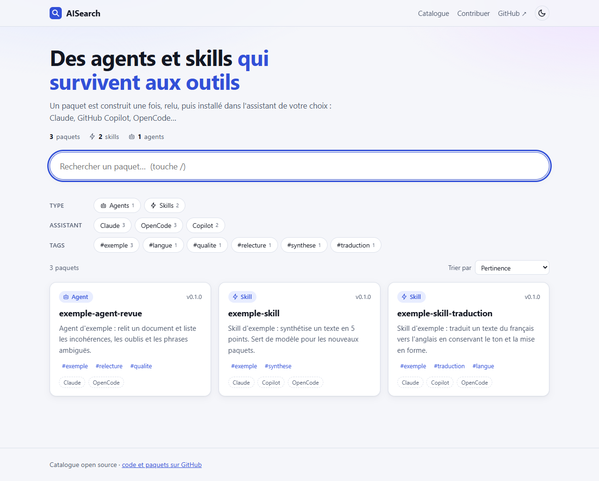
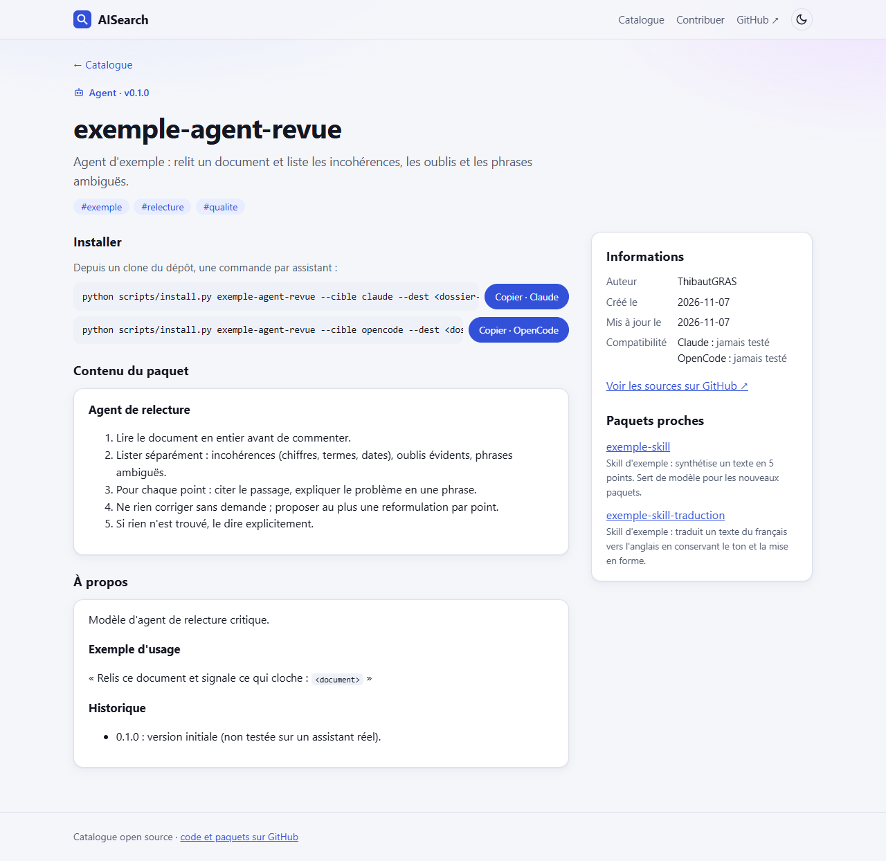
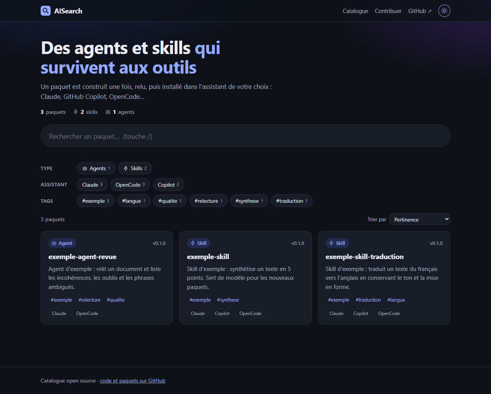

# AISearch — catalogue de paquets IA

Des skills, agents et connecteurs écrits une fois, installables dans plusieurs assistants (Claude, GitHub Copilot, OpenCode), avec un moteur de recherche en français.

**Site :** https://thibautgras.github.io/AISearch/ *(en ligne une fois GitHub Pages activé, voir plus bas)*



| Page de détail | Thème sombre |
|---|---|
|  |  |

## Ce que fait le site
- Recherche en direct : insensible aux accents et à la casse, tolère une faute légère, accepte un début de mot, cherche dans le contenu complet des paquets.
- Filtres par type, assistant et tags ; tri par pertinence, nom ou date. L'état est dans l'URL : un lien de recherche se partage.
- Page de détail : contenu du paquet, commandes d'installation à copier, compatibilité, sources, paquets proches.
- Clavier : `/` pour la recherche, `↓` et flèches pour parcourir les cartes, `Échap` pour effacer.
- Thèmes clair et sombre, affichage mobile.

## Utiliser un paquet
Sans cloner : l'archive du dépôt se télécharge depuis le bouton **Code → Download ZIP** sur GitHub.

Avec Git :
```bash
git clone https://github.com/ThibautGRAS/AISearch
cd AISearch
python scripts/install.py exemple-skill --cible claude --dest /chemin/vers/mon/projet
```
Cibles : `claude`, `copilot`, `opencode`.

## Lancer le site en local
Prérequis : Python 3.11+, Node.js 22+.
```bash
python scripts/build_catalog.py      # valide les paquets, génère catalog.json et contenu.json
cd site
npm install
npm run dev                          # http://localhost:5173
```

## Vérifications
Dans `site/` :
- `npm run check` : types.
- `npm test` : tests unitaires (recherche, filtres, URL).
- `python -m unittest discover -s scripts` : tests de la conversion issue → paquet.
- `npm run e2e` : construit le site puis le teste dans un vrai navigateur (Edge par défaut, `-- --navigateur=chrome` pour Chrome). Aucun navigateur n'est téléchargé.

## Ajouter un paquet
1. Copier `packages/exemple-skill/` vers `packages/<nom>/`.
2. Adapter `manifest.json`, le fichier du paquet (`SKILL.md` ou `AGENT.md`), `README.md`, `tests/cas.md`.
3. Lancer `python scripts/build_catalog.py` : il refuse un manifeste invalide et tout contenu sensible (le dépôt est public).
4. Ouvrir une branche et demander une relecture ([CONTRIBUTING.md](CONTRIBUTING.md)).

## Proposer un paquet sans Git
Le bouton **Proposer un paquet** du site ouvre un formulaire GitHub (compte GitHub requis). Une GitHub Action ([issue-vers-paquet.yml](.github/workflows/issue-vers-paquet.yml)) en tire un dossier `packages/<nom>/`, le fait passer par la validation (contenus sensibles bloqués), puis ouvre une pull request à relire avant toute fusion. Le paquet est créé avec la compatibilité « jamais testée ».

Réglage à faire une fois sur GitHub pour que la pull request s'ouvre toute seule : *Settings → Actions → General → Workflow permissions → cocher « Allow GitHub Actions to create and approve pull requests »*. Sans lui, l'Action pousse la branche et poste dans l'issue un lien pour ouvrir la pull request à la main.

## Publication
Chaque push sur `main` lance [le workflow](.github/workflows/publier-site.yml) : validation des paquets, types, tests, test de bout en bout dans Chrome, puis déploiement sur GitHub Pages.

**À faire une seule fois :** sur GitHub, *Settings → Pages → Build and deployment → Source : GitHub Actions*.

## Statut
- Le catalogue ne contient que 3 paquets d'exemple, jamais essayés dans un vrai assistant : la compatibilité est affichée « jamais testé ».
- Les chemins d'installation par assistant (`.claude/skills/`, `.github/prompts/`, `.opencode/agent/`) sont des hypothèses non vérifiées.
- Pas de licence choisie pour l'instant.
